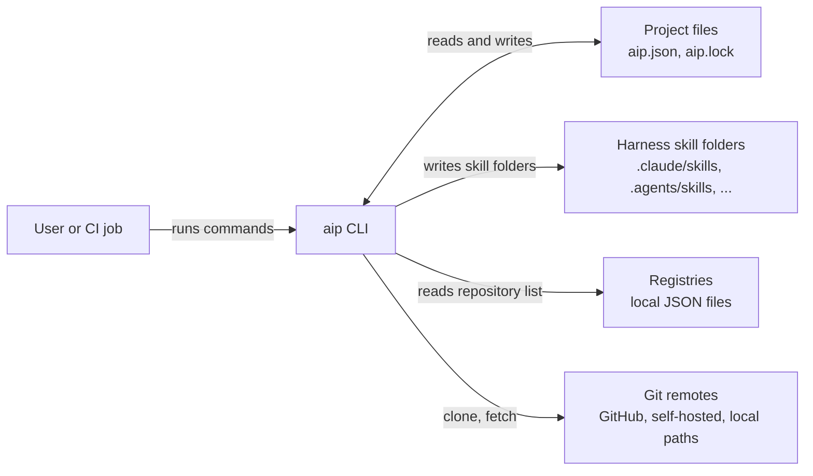

# 03 Context and scope

Purpose: the system boundary and what lies outside it.

## Business context

The user (or a CI job) runs `aip`.
aip reads the registries to learn repository URLs (and names, derived from the URLs unless set), fetches those repositories from their git remotes, and copies skill folders into the folders the AI harnesses read.
The harnesses themselves are not called; aip only writes files they pick up.

| Partner | Direction | Content |
|---|---|---|
| User | in | Command line, `aip.json` edits |
| Registry file | in | `{"repositories": [{"url", "name"?}]}` |
| Git remote | in | Repository objects (tags, branches, `skills/<skill>/...`) |
| Harness skill folder | out | Skill folder per package |
| `aip.json`, `aip.lock` | in and out | Requirements and resolved state |

## Technical context

| Interface | Technology |
|---|---|
| Command line | `clap`, exit code 0 or 1, errors as `error: <message>` on stderr |
| Git | `git` child processes (`clone --mirror`, `fetch --prune`, `ls-tree`, `cat-file`, `rev-parse`, `for-each-ref`, `symbolic-ref`) |
| Registry | JSON file on disk |
| Configuration | `AIP_HOME`; `HOME`/`USERPROFILE`; `CLAUDE_CONFIG_DIR` and `CODEX_HOME` for `detect --global` and the global skill folders (`--global` installs) |

## Out of scope

- Running or validating skills.
- Authentication: aip delegates to the user's git configuration.
- Dependencies between skills. A skill cannot require another skill.
- Hosting registries. Only the file format is defined.
