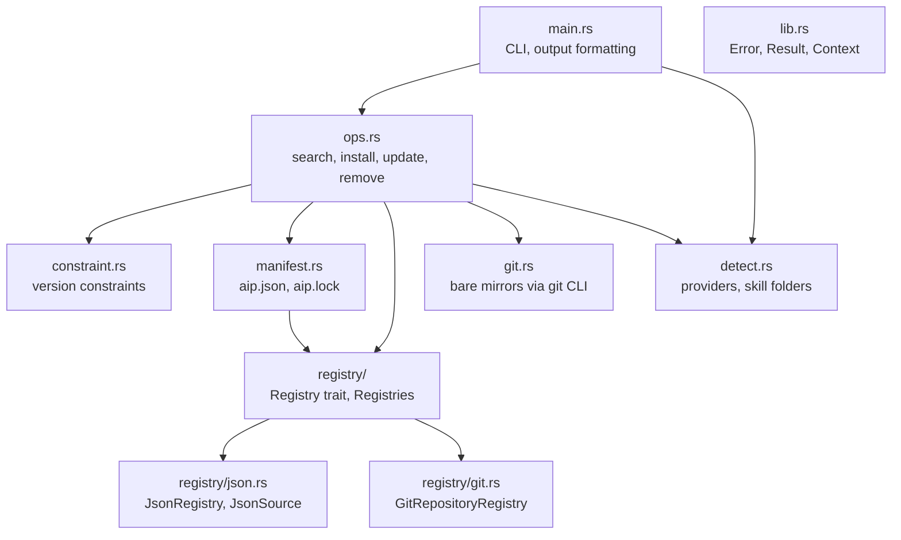
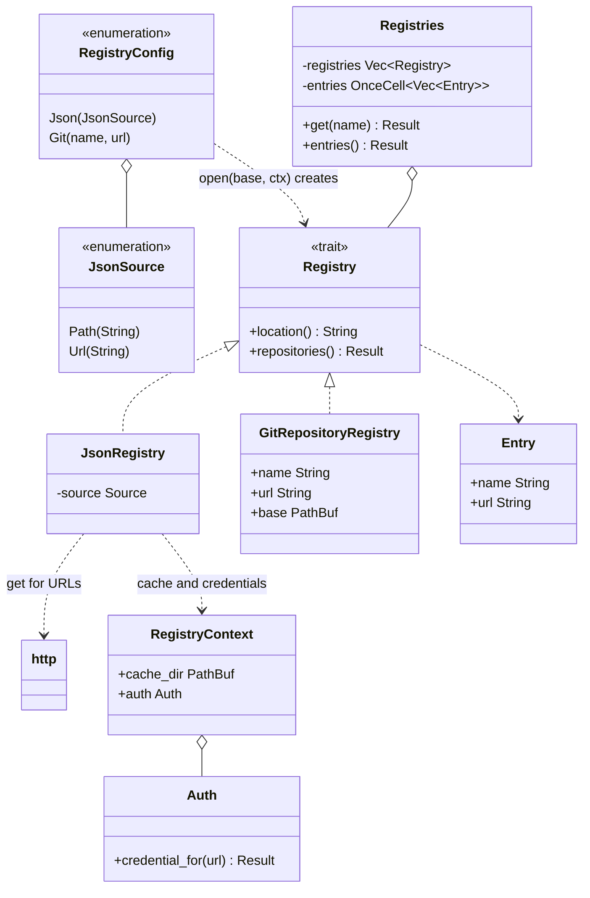

# 05 Building block view

Purpose: the static structure of the code and the responsibility of each module.

## Level 1: crate

One crate, `aip`, with a library (`src/lib.rs`) and a binary (`src/main.rs`).

Every module also uses `Error`, `Result` and `Context` from `lib.rs`; those arrows are left out.
`main.rs` calls `detect` directly for the `detect` command and for locating the home folder.

## Module responsibilities

| Module | Responsibility | Key items |
|---|---|---|
| `main.rs` | Parse arguments (clap), call `ops` or `detect`, print results exactly as documented, turn errors into `error: ...` and exit code 1. | `show`, `run_search`, `print_table` |
| `lib.rs` | Error type with a ready-to-show message; `Context` extension to prefix underlying errors. | `Error`, `Result`, `Context` |
| `ops.rs` | All use cases. Resolves packages, builds a plan, writes lock and files. | `install`, `update`, `remove`, `search`, `Project`, `Resolver`, `plan`, `apply`, `Change`, `Report` |
| `constraint.rs` | Parse and match Composer constraints; parse tags into versions; default constraint. | `Constraint`, `satisfies`, `parse_version`, `default_for` |
| `manifest.rs` | Types and I/O for `aip.json` and `aip.lock`; Composer-style JSON writer that skips unchanged files. | `Manifest`, `Lock`, `LockedPackage`, `Source`, `write_json` |
| `registry/mod.rs` | `Registry` trait, `RegistryConfig`, priority merge, name validation, `SKILL.md` description reader. | `Registry`, `RegistryConfig`, `Registries`, `valid_name`, `split_package`, `description` |
| `registry/json.rs` | Registry stored as a JSON document, read from a file or downloaded; validates entries, resolves relative local URLs of file registries, allows only remote git URLs in downloaded ones. For URLs: conditional request, cache write after validation, fallback to the cached copy. | `JsonRegistry`, `JsonSource` |
| `registry/cache.rs` | On-disk copy of downloaded registry documents: one JSON file per URL, atomic write, age text. Never holds credentials. | `CacheEntry`, `load`, `store`, `describe_age` |
| `auth.rs` | Reads `AIP_AUTH` and `auth.json` files, merges them per host, picks the credential for a URL, applies the https policy, builds the `Authorization` value. Redacts secrets in `Debug` and errors. | `Auth`, `Credential`, `host_key` |
| `registry/git.rs` | Registry with one inline repository from `aip.json`; validates name and URL. | `GitRepositoryRegistry` |
| `http.rs` | Blocking HTTP GET of a text document (ureq, rustls with ring): 30 s timeout, size limit, conditional headers, optional credential. Follows redirects by hand when a credential is attached and drops it on another origin. Classifies failures so callers can tell "unreachable" from "refused". | `get`, `Request`, `Response`, `HttpError` |
| `git.rs` | Mirror clone/fetch and read-only access to objects: tags, branches, tree listing, blob reading, export to a folder. | `Repo` |
| `detect.rs` | Table of providers (markers, skill folders, env overrides) and the detection routine. | `PROVIDERS`, `detect`, `global_root`, `marker_path` |

## Dependency rules

- `constraint.rs`, `detect.rs` and `git.rs` do not depend on other aip modules (except `lib.rs`).
- `ops.rs` is the only module that combines them.
- Nothing below `main.rs` prints results.
  The only output from the library is progress and warnings on stderr (`Fetching ...`, `warning: ...`), listed as debt in [11](11-risks-and-technical-debt.md).
- `registry/` knows nothing about git or the file system layout of skills.
  It returns `Entry { name, url }` only.

## Level 2: ops internals

| Part | Role |
|---|---|
| `Project` | Where manifest and lock live and which folder skill paths are relative to. `Project::local(dir)` or `Project::global(home)`. |
| `Resolver` | Opens registries, syncs each repository at most once per run, resolves a name and constraint to a `LockedPackage`. |
| `refresh` | Brings a `Lock` in line with a `Manifest`: drops unrequired entries, resolves missing, unsatisfied or forced ones. |
| `plan` | Compares old and new lock with the disk. Produces `Change`s and a list of writes and removals. Enforces the unmanaged-folder rule. |
| `apply` | Deletes, exports to staging, swaps. |
| `finish` | `plan`, write `aip.json`, write `aip.lock`, then `apply`. |

## Registry abstraction

Today a registry maps repository names to git URLs, nothing more.
There are two types: `json` (a file or a URL with many repositories) and `git` (one repository declared inline in `aip.json`).
Both share `validated_entry`: name check, credential guard, relative path resolution.
A `json` registry reads its text from a file or from `http::get`; parsing and validation are shared.
For a URL it also uses the `RegistryContext` that `Project::registries` builds once: the cache folder and the `Auth`.
The config takes exactly one of `path` and `url`, checked when `aip.json` is parsed.

- `RegistryConfig` is the serialised form inside `aip.json`. `open(base, ctx)` turns it into a `Box<dyn Registry>`; `base` is the folder of `aip.json`, used for relative paths.
- `Registries` holds the boxes in priority order. On first use it calls `repositories()` on each registry and keeps the first entry for every name. A failure in any registry fails the whole call.
- `Project::registries` builds `Registries` from `aip.json`, or from `$AIP_HOME/registry.json` when `aip.json` lists none.
- Callers outside `registry/` only see `Registries::get` and `entries`, plus `Entry`.

### Adding an HTTP registry

This is how a server registry would be added; none of it exists yet. `http::get` already exists for it.

1. Add a variant to `RegistryConfig`, for example `Http { url: String }`. The serde tag turns it into `{ "type": "http", "url": "https://..." }` in `aip.json`. `deny_unknown_fields` and the `lowercase` rename already apply.
2. Add `registry/http.rs` with a struct that implements `Registry`. `location()` returns the URL for messages. `repositories()` fetches a JSON list and returns `Entry { name, url }` values. It must apply the same checks as `JsonRegistry`: `valid_name`, no duplicates, no unknown keys.
3. Add the match arm in `RegistryConfig::open`.
4. Reuse `http::get` (blocking ureq client, [ADR 0008](../decisions/0008-http-client-ureq.md)).

Nothing in `ops.rs`, `manifest.rs` or `git.rs` changes for this minimal version.
The server only supplies the list; versions still come from git tags, and `aip.lock` still records git URL and commit.
Priority works unchanged because `Registries` does not care which kind of registry produced an entry.

Two small caveats in today's code: `open` cannot fail, so a bad URL has to surface from `repositories()`; and `repositories()` returns the full list at once, so a large server catalogue would be downloaded on every run that needs the registry.

### What richer server capabilities would change

| Capability | Change needed |
|---|---|
| Search API | Add an optional method such as `search(&self, query) -> Result<Option<Vec<SearchHit>>>` to `Registry`, with a default that returns `None`. `ops::search` would use the answer when present and fall back to cloning every repository when not. This removes the "search fetches everything" limit in [11](11-risks-and-technical-debt.md). |
| Version and description metadata | Add a method to list versions per package, with the same default fallback to git tags. `Resolver::resolve` and `default_constraint` would try it before cloning. The lock must still record the git URL and commit, so `install` from the lock stays independent of the server. |
| Lookup by name instead of full list | Add `get(&self, name) -> Result<Option<Entry>>`. `Registries::get` would ask registries in order instead of loading every entry. |
| Authentication | `auth.json` and `AIP_AUTH` already cover HTTP downloads ([ADR 0009](../decisions/0009-auth-json-for-http-registries.md)). A server registry reuses `Auth::credential_for`. |
| Richer entries (owner, license, topics) | `Entry` derives `Deserialize` with `deny_unknown_fields` for the JSON file. A server entry needs its own wire type that maps to `Entry`. |

These are design directions, not commitments.
See [ADR 0005](../decisions/0005-pluggable-registries.md).
