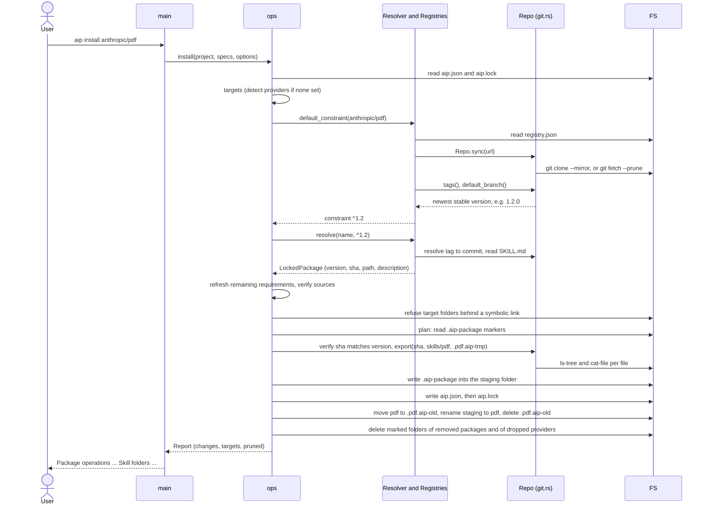
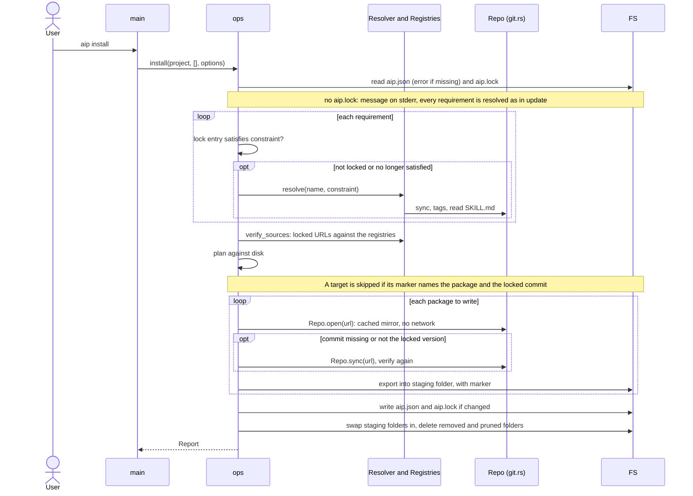
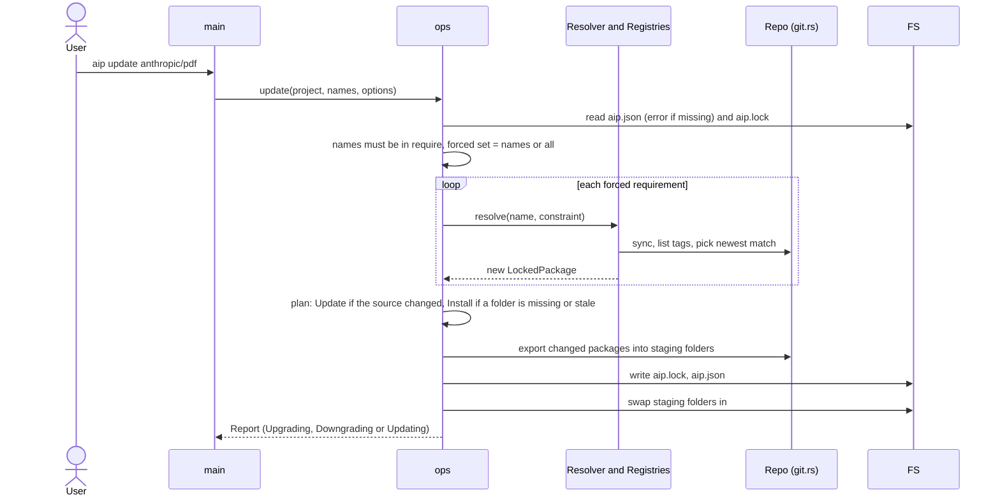
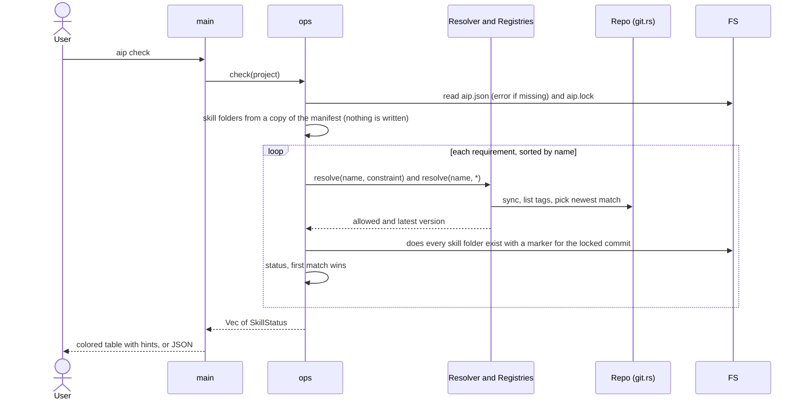
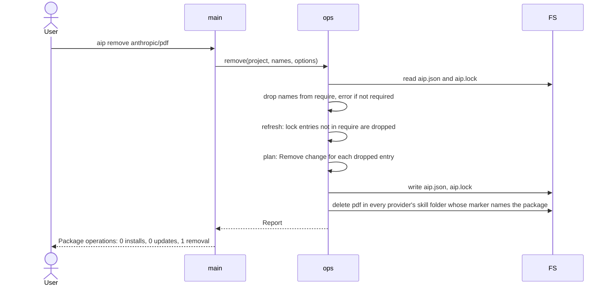
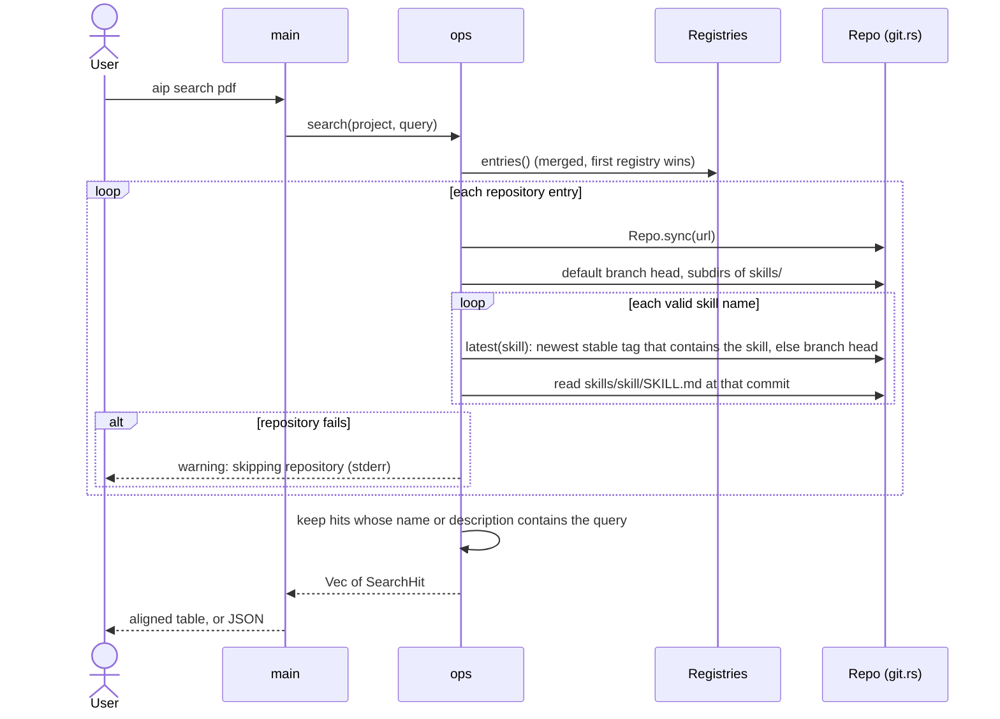
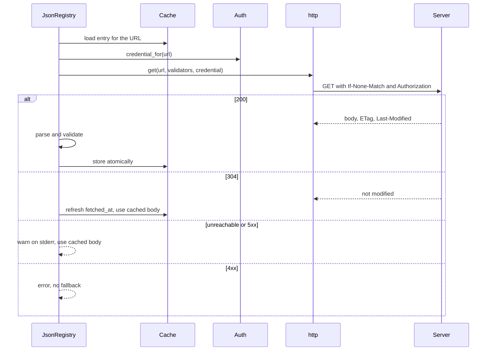

# 06 Runtime view

Purpose: the main flows, step by step.
Participants: `main` (CLI), `ops`, `Resolver` (inside `ops`), `Registries`, `Repo` (`git.rs`), `git` (the child process), `FS` (files on disk).

## Install a named package

`aip install anthropic/pdf`

If a constraint is given (`anthropic/pdf:^1.2`), the `default_constraint` step is skipped and the constraint is parsed instead.
`plan` fails before anything is written if a target folder exists and its `.aip-package` marker does not name the package (see 08, "Ownership of skill folders").
With `--dry-run`, `finish` returns the report after `plan` and writes nothing.
If any export fails, the staging folders are deleted and aip.json, aip.lock and the skill folders stay as they were.

## Install from the lock

`aip install` without arguments

The registries are always read, because `verify_sources` checks every locked URL against them.
A local registry file needs no network; a URL registry falls back to its cached copy (see "Fetch a URL registry").
Git repositories are not fetched when the cached mirror already has the locked commit and that commit matches its version label.
When every folder is up to date, no git process runs.

## Update

`aip update [packages]`

Packages not in the forced set are kept at their locked version as long as they still satisfy their constraint.

## Check

`aip check`

A package that cannot be resolved gets an `error` status and the loop continues.
Check takes no project lock and writes nothing except the git cache, which `Repo.sync` locks.
`main` exits with 1 when a row has an `error` status, and with `--strict` when any row is not `up to date`.

## Remove

`aip remove anthropic/pdf`

`remove` makes no network access, unless the remaining requirements need resolving.
It never forces: `plan` is called with `force = false`.
A folder is deleted only if its `.aip-package` marker names the removed package, so a tampered aip.lock cannot delete a user's own folder.
Unmarked folders in a target get `warning: not removing <path>: it was not installed by aip`.

## Search

`aip search pdf`

Search uses the registries of the project, or of the global `aip.json` with `--global`.
It does not write anything except the git cache.

`aip info <repository>/<skill>` runs a shorter flow: `Registries::get` finds only the named repository, only that repository is synced, and the skill is read at its `latest` version.

## Fetch a URL registry

A `json` registry with a `url` is read when `Registries::entries` first needs it.
The flow is the same for every command that resolves a name.

Without a cache entry, the unreachable and 5xx cases are errors too.
