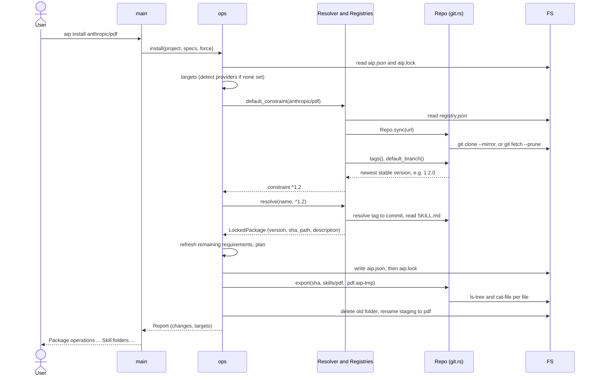
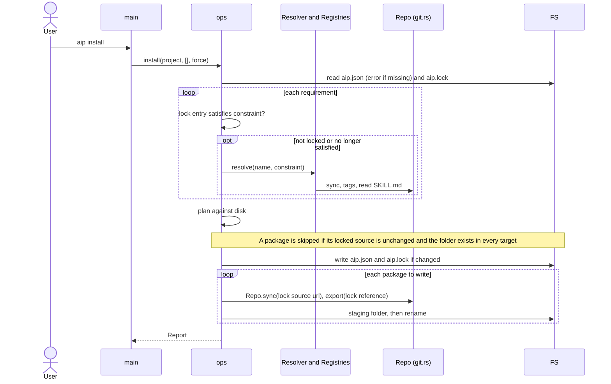
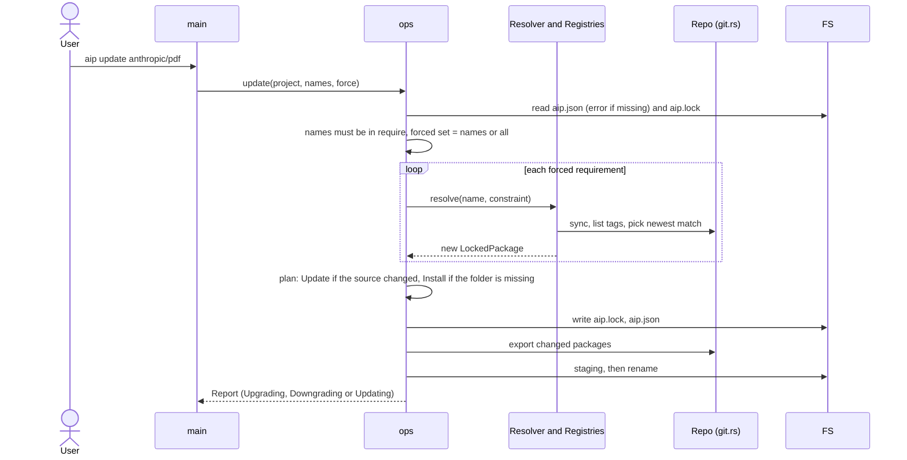
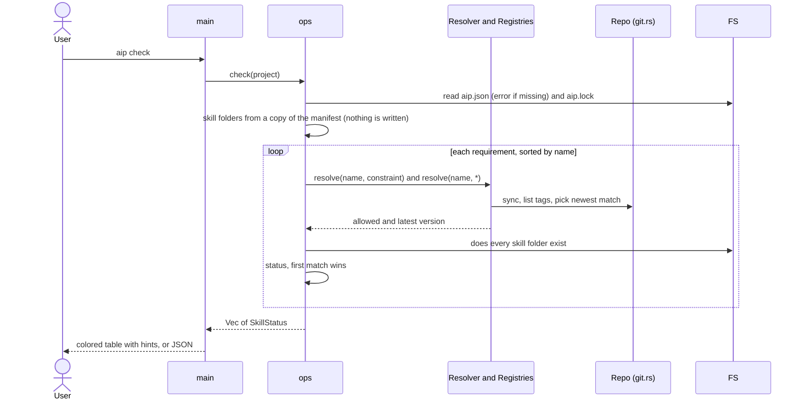
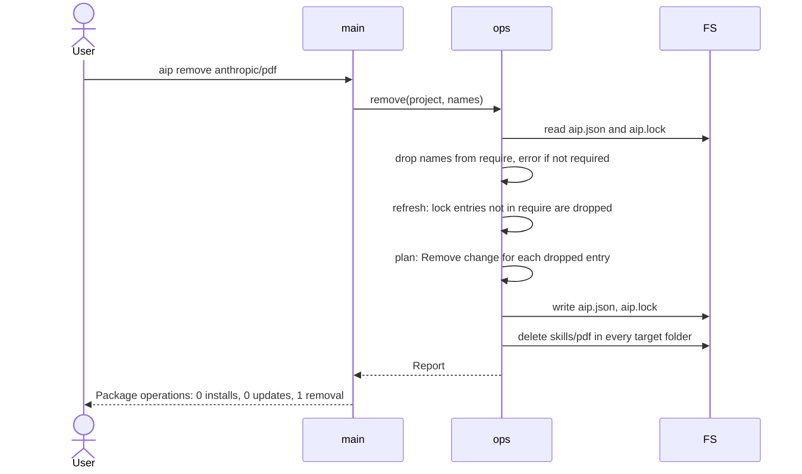
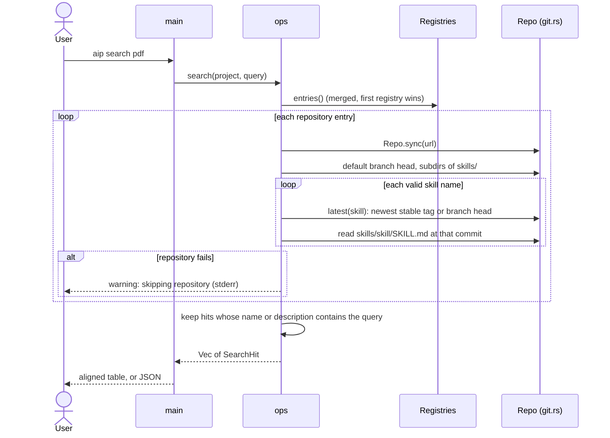
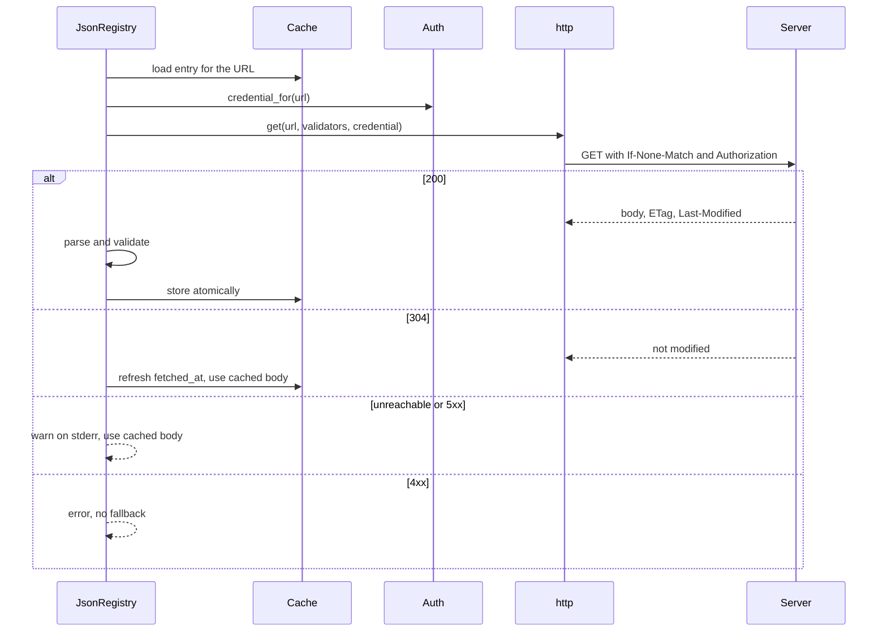

# 06 Runtime view

Purpose: the main flows, step by step.
Participants: `main` (CLI), `ops`, `Resolver` (inside `ops`), `Registries`, `Repo` (`git.rs`), `git` (the child process), `FS` (files on disk).

## Install a named package

`aip install anthropic/pdf`

If a constraint is given (`anthropic/pdf:^1.2`), the `default_constraint` step is skipped and the constraint is parsed instead.
`plan` fails before anything is written if a target folder exists and the lock does not list the package.

## Install from the lock

`aip install` without arguments

When everything is locked, the registry is never read; aip fetches the URL stored in the lock.
When nothing is missing, no git process runs.

## Update

`aip update [packages]`

Packages not in the forced set are kept at their locked version as long as they still satisfy their constraint.

## Check

`aip check`

A package that cannot be resolved gets an `error` status and the loop continues.
Check takes no project lock and writes nothing except the git cache, which `Repo.sync` locks.

## Remove

`aip remove anthropic/pdf`

`remove` makes no network access, unless the remaining requirements need resolving.
It never forces: `plan` is called with `force = false`, and removals are limited to lock entries.

## Search

`aip search pdf`

Search is always project scope.
It does not write anything except the git cache.

## Fetch a URL registry

A `json` registry with a `url` is read when `Registries::entries` first needs it.
The flow is the same for every command that resolves a name.

Without a cache entry, the unreachable and 5xx cases are errors too.
