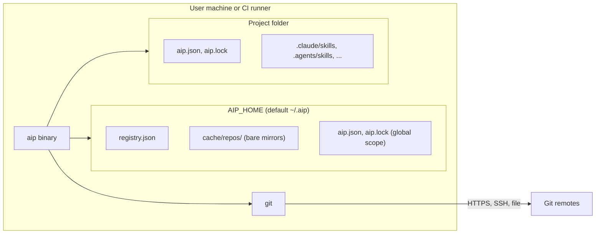

# 07 Deployment view

Purpose: how aip is built, shipped and run, and how the dev and CI environments look.

## Runtime

aip is one native binary.
It needs `git` on the `PATH` and nothing else.
There is no daemon, no server and no installer.
Releases are built from source with `cargo build --release`; the repository has no release or packaging workflow yet.

In global scope the skill folders are under the user's home folder, and the manifest and lock sit in `$AIP_HOME`.

## Development environment

| Piece | File | Notes |
|---|---|---|
| Dev image | `Dockerfile` | `rust:1.97-slim`, adds rustfmt, clippy and git. Creates a user with the host UID and GID so bind-mounted files are not root-owned. `CARGO_TARGET_DIR=/target`. |
| Compose | `compose.yaml` | One service `dev`. Mounts the repository at `/workspace`. Named volumes `cargo-registry` and `cargo-target` keep dependency and build caches. |
| Makefile | `Makefile` | `make image`, `shell`, `build`, `release`, `run ARGS=...`, `fmt`, `fmt-check`, `lint`, `test`, `check`, `clean`, `nuke`. Passes `HOST_UID` and `HOST_GID` to Compose. |

The only host requirements are Docker Compose and `make`.
See [ADR 0006](../decisions/0006-docker-compose-dev-environment.md).

## CI

`.github/workflows/ci.yml` runs on pushes to `main` and on pull requests.

| Aspect | Value |
|---|---|
| Matrix | `ubuntu-latest`, `macos-latest`, `windows-latest`, `fail-fast: false` |
| Toolchain | `dtolnay/rust-toolchain@stable` with rustfmt and clippy |
| Steps | `cargo fmt --check`, `cargo clippy --all-targets -- -D warnings`, `cargo test` |
| Caching | `Swatinem/rust-cache@v2` |
| Other | Read-only `contents` permission; concurrent runs of one ref are cancelled |

CI runs natively, not in the Docker image.
The Docker image pins Rust 1.97, CI uses `stable`, and `Cargo.toml` declares `rust-version = "1.89"`.
These three can drift apart.
